# Historical workbook workflow (v0.3)

This is the pre-redesign README, retained for the still-supported compatibility
workbook command. Start with the [current README](../../README.md) for Step 0.
The Milestone 1 `trial-design` CLI and synthetic demo mentioned below have been
retired; their original code is recoverable from Git commit `b7825b2`.

# Trial Design Workflow

Generate one reviewable SDTM Trial Summary (TS) Excel draft from an NCT ID, a
local protocol PDF, or both. The workbook is a broad candidate list for a clinical
programmer to edit and delete from. Every value is proposed and needs review.

## Run

Python 3.11+ and [uv](https://docs.astral.sh/uv/) are required.

```sh
uv sync --extra dev --locked

# Registry mode: reads one public ClinicalTrials.gov API v2 record
uv run trial-ts --nct-id NCT04074161 --output outputs/study-a-registry

# Protocol mode: reads the PDF locally, without uploading it
uv run trial-ts --protocol data/source_documents/study_a_NCT04074161_STEP8_protocol.pdf --output outputs/study-a-protocol

# Hybrid mode
uv run trial-ts --nct-id NCT04074161 --protocol data/source_documents/study_a_NCT04074161_STEP8_protocol.pdf --output outputs/study-a-hybrid
```

Each command writes only `TS_Draft.xlsx` in the chosen directory. A direct
`--output outputs/draft.xlsx` path also works. Existing workbooks are never
overwritten, including programmer edits. NCT IDs must match `NCT` plus eight digits.

For offline replay, add `--registry-json path/to/saved-api-response.json` alongside
`--nct-id`. The snapshot must contain the same NCT ID. A supplied snapshot's
original fetch time is recorded as unknown; no new network request is made.

## Input → TS Parameter Registry → Excel Output

Both adapters produce the same Study Facts: field key, proposed value, source
type, locator, evidence, context, extraction status and review status. The PDF
adapter reuses the existing page-grounded regex extraction. It reads plain text
locally, without OCR, an LLM or uploading document content. API fields retain
their JSON paths and estimated/actual qualifiers.

Reconciliation is deterministic:

- Values matching after whitespace collapse and case folding are grouped;
  original values and all sources remain in evidence.
- One available source is labelled `single_source`, even in Hybrid mode.
- Different values are labelled `conflict`; neither source wins and TSVAL stays
  empty. Disagreements within one source are retained too.
- Planned and actual enrollment are separate fact keys. Date types are retained.
  A protocol NCT ID inconsistent with the requested registry study stops merging.
  If the protocol has no discoverable NCT ID, the workbook flags identity review.

[](ts-workflow.svg)

## Review the workbook

| Sheet | Contents |
| --- | --- |
| TS_Draft | STUDYID, DOMAIN, TSSEQ, TSPARMCD, TSPARM, TSVAL only |
| Parameter_Review | Every candidate, recommendations, missing/conflicting values, applicability, sources, CT checks and editable review notes |
| Evidence_QC | Source quotes/JSON paths, field contexts, unmapped facts, QC and a small embedded run summary |

The default draft keeps all 129 candidate parameters visible. Empty TSVAL cells
are review placeholders, not null flavors. Values appear only when a configured
mapping has one reconciled value and passes the selected checks; this never
makes them approved. Single-source facts remain explicitly unverified. Invalid
or unavailable CT mappings stay empty, with raw values retained for review.

Edit/delete rows in TS_Draft directly. KEEP/DELETE/CHECK actions and notes in
Parameter_Review are annotations; they do not recalculate or approve TS_Draft.
TSSEQ is assigned by sorted TSPARMCD at generation; renumber it after final edits.
Protocol-only STUDYID uses a single extracted sponsor identifier, or a labelled
technical ID derived from the PDF hash when unavailable/ambiguous.

## Registry, terminology and known limits

The version-controlled parameter CSV is
[`ts-parameters-v1.csv`](../../src/trial_design_workflow/assets/ts-parameters-v1.csv).
It contains all 129 terms in NCI's TSPARMCD codelist C66738 in the explicitly
selected **SDTM CT 2025-03-28** release, joined to C67152 for exact parameter
names. This is a candidate superset, not a list of required study parameters.
Some terms target other contexts and will need deletion.

A small [CT snapshot](../../src/trial_design_workflow/assets/ct-2025-03-28.csv) and its
[source URL, scope and SHA-256 hashes](../../src/trial_design_workflow/assets/sources.json)
are bundled. Eleven fact mappings are currently implemented. Applicability is
left for review by default. The code supports explicit review/include-if-present/
exclude/external rules and exact CT lookup. Phase and masking aliases are
versioned project normalization suggestions and must match the pinned CT;
unknown terms are not guessed. Optional `--registry custom.csv --ct custom-ct.csv`
inputs must explicitly declare matching versions/releases.

**Authoritative gaps:** SDTMIG v3.4, its underlying model, selected errata, and
submission-context applicability/requiredness rules have not been supplied.
The loaded CT subset does not establish complete TS requirements or all response
codelists. No required/conditionally-required claim or submission-ready claim
is made. These limitations appear in Evidence_QC as well.

PDF extraction is an initial ten-field regex baseline. It can expose totals
versus arm counts and protocol versus attachment versions as conflicts; it does
not resolve them. Cross-page blocks, tables and complex design interpretation
need manual review. Source values over 200 characters or containing control
characters are held for review without splitting; 200 is a project threshold,
not a claimed CDISC limit. Unrepresentable Excel text fails explicitly.

The embedded run summary records input mode, NCT ID, protocol/payload hashes,
registry fetch time, registry version, CT release and software version. Logical
records are reproducible for identical inputs, registry, CT and parser environment.
Live registry records can change. Source assets and the environment lockfile must
be retained separately for long-term replay.

## Real-study proof-of-concept cases

Two publicly accessible registry documents are available locally for protocol
extraction and evaluation:

- **Study A — development case:** STEP 8 (`NCT04074161`), a Phase 3b study of
  semaglutide versus liraglutide with pairwise placebo control.
- **Study B — held-out evaluation case:** LIMIT-JIA (`NCT03841357`), a Phase 3
  abatacept study with a design modification and registry-derived external
  comparator.

Their source URLs, versions, local filenames, download dates, page counts, and
SHA-256 digests are recorded in [`config/studies.json`](../../config/studies.json).
Local protocol PDFs belong in `data/source_documents/` and are ignored by Git.
The registry documents are publicly accessible inputs, but public access must
not be treated as a grant to redistribute or as public-domain status.

Study B remains held out until the Study A extraction workflow, rules, and
prompts are frozen. If Study B results later drive changes, preserve and label
the original evaluation before running post-evaluation regressions.


## Development and checks

```sh
uv run pytest
uv run ruff check .
uv run ruff format --check .
```

Tests use fictional API fixtures and generated synthetic PDFs without network
access. They cover all three modes, agreement/conflict/missing-source behavior,
identity checks, deterministic ordering, CT lookup, formula-injection protection,
workbook reopening, columns, row counts and key values. A real Study A smoke test
is separate from fixture tests; it does not establish extraction accuracy.

The earlier `trial-design` and `trial-extract` experiments and their tests are
retained for compatibility. They are not needed by the user path above. Earlier
milestone documents describe those experiments, not additional required steps.
There is no approval platform, database, Web UI, other SDTM domain, XPT,
Define-XML or automated Pinnacle 21 workflow.

Local protocol PDFs and extracted source text must stay out of Git. Runtime
workbooks and downloaded source material stay under ignored `outputs/`. No
protocol content is sent to ClinicalTrials.gov; the only outgoing study lookup
uses the supplied NCT ID.
