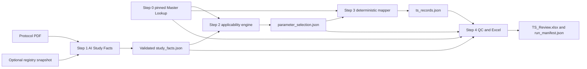

# Lean Lookup First SDTM TS MVP Implementation Plan

## Purpose and decision

Confirmed refinement (2026-10-26): the first MVP delivers a draft only. It has no
finalize, workbook-import or exception-resolution approval workflow. Codex-assisted
fact proposals are saved and independently validated by the Python package; no new
direct model API call is selected by default. This does not authorize remote
protocol transmission. Step 0 content work is detailed in
`docs/step-0-content-review.md`: readable joined review, per-parameter source gaps,
separate variable metadata and source-backed content before qualified signoff.

Current baseline (2026-10-26): the user accepted clinical profile v3 provisionally,
with later refinement and notes for unresolved processing. The selected CT is the
hash-pinned 2026-09-25 release; nine source differences have recorded dispositions.
See `docs/step-0-full-lookup.md` and `docs/known-limitations.md`. This acceptance
does not manufacture a qualified signoff. Version 0.5.0 publishes the Step 0 work
and repository cleanup before Step 1 starts.

This document is an execution specification for redesigning the existing
[`brendazhang51/trial_design_workflow`](https://github.com/brendazhang51/trial_design_workflow)
repository into a lean, lookup-first workflow that produces an auditable, human-reviewed SDTM Trial Summary draft.
It is written for Codex to plan and implement against the live repository. It does not authorize code changes by
itself.

The target design has one non-negotiable boundary: AI may propose protocol Study Facts with page-level evidence,
but it must not decide which TS parameters apply, invent terminology, or write final TS rows. Applicability,
terminology mapping, TS row generation, and machine QC are deterministic and driven by a complete, versioned
Master Lookup. Exceptions and unsupported cases remain visible for human review.

Implementation must finish and pass the five MVP gates before any repository-level Codex Skill is added. The
Skill is a thin orchestration and review layer around a working Python package; it is not deployment, a substitute
for the package, or a second implementation of its rules.

## Plan first Codex prompt

Copy the prompt below into a new Codex task opened on the repository. The first Codex response must be a plan,
not edits.

```text
You are working in the repository brendazhang51/trial_design_workflow.

Read the repository instructions and inspect the live repository before proposing changes. Read this file in full:
trial_design_workflow_lean_ts_mvp_implementation_plan.md. Treat it as the implementation contract, but verify every
stated path and baseline fact against the current checkout. If the repository has moved beyond baseline commit
b7825b2f0d06ac7349bb71f3db43f8562240a988, identify the material differences and adapt the plan without silently
dropping any acceptance gate.

This is a plan-first task. Do not edit files, install dependencies, change standards assets, create a branch, or begin
implementation in your first response.

First produce:
1. a concise repository assessment tied to exact files and symbols;
2. a proposed target file tree and migration map from current files to target files;
3. a phased implementation plan in this exact order: Step 0 Master Lookup, Step 1 AI Study Facts, Step 2 parameter
   selection, Step 3 deterministic mapping and TS generation, Step 4 QC and Excel, then repository-level Codex Skill;
4. for every phase, the files to add/change, tests to add/change, compatibility effects, data migrations, risks, and
   the acceptance commands and expected evidence;
5. all unresolved standards or product decisions that require human approval, clearly separated from engineering
   decisions Codex can make safely;
6. a proposal for small, reviewable PRs or commits, with an explicit stop-and-review gate after Step 0 and after the
   complete MVP before Skill packaging.

Hard constraints:
- Preserve protocol privacy: local PDFs and extracted text remain outside Git; do not send protocol content to a
  remote service unless the user explicitly selects and authorizes a provider.
- AI output is untrusted, schema-validated, evidence-grounded Study Facts. AI never directly emits or edits TS rows.
- Step 2 through Step 4 must replay without a network call from pinned inputs and assets.
- A missing fact is not equivalent to a non-applicable parameter.
- Do not treat the full NCI TSPARMCD codelist as a required study parameter list.
- Do not treat PharmaSUG 2016 DS11 as current normative guidance. Use it as historical design rationale only.
- Pin and record SDTM/SDTMIG, errata, CT, CT relationship/codetable mapping, and FDA reference versions. A latest
  online source may be used to build a new asset only through an explicit asset-update workflow and review.
- Preserve raw values, source evidence, and every exception. Never guess an unmapped controlled term.
- Keep Study Start Date semantics separate from a registry-reported start date; do not automatically map the latter
  to SSTDTC.
- Do not add XPT, Define-XML, automated Pinnacle 21, a database, a web UI, or approval workflow to this MVP.
- Keep the existing public CLI working during migration or document and test an intentional deprecation path.
- Run the existing tests before changes and the full locked verification stack after each phase.
- Do not create `.agents/skills/trial-ts/` until Steps 0-4 meet the MVP acceptance gate and a human explicitly
  approves Skill packaging.

Use the detailed contracts, acceptance gates, and deliverables in the implementation-plan document. End the first
response with: “Awaiting approval to implement Step 0.”
```

## Verified repository baseline

This plan was prepared against `main` commit `b7825b2f0d06ac7349bb71f3db43f8562240a988`. The locked baseline
test suite passed: `93 passed`.

Current behavior that the migration must account for:

- `trial-ts` accepts a ClinicalTrials.gov record, a local protocol PDF, or both, and writes one `TS_Draft.xlsx`.
- [`src/trial_design_workflow/assets/ts-parameters-v1.csv`](https://github.com/brendazhang51/trial_design_workflow/blob/b7825b2f0d06ac7349bb71f3db43f8562240a988/src/trial_design_workflow/assets/ts-parameters-v1.csv)
  contains all 129 terms from TSPARMCD in the pinned 2025-03-28 CT release. Every row currently has
  `applicability_rule=review`; therefore this is a terminology-derived candidate universe, not a complete
  applicability lookup.
- [`ts_registry.py`](https://github.com/brendazhang51/trial_design_workflow/blob/b7825b2f0d06ac7349bb71f3db43f8562240a988/src/trial_design_workflow/ts_registry.py)
  validates the current registry, applies a small set of project aliases, performs exact CT lookup, and creates one
  candidate per registry row.
- [`inputs.py`](https://github.com/brendazhang51/trial_design_workflow/blob/b7825b2f0d06ac7349bb71f3db43f8562240a988/src/trial_design_workflow/inputs.py)
  extracts registry facts and reuses a ten-field, page-local regex protocol baseline. Eleven fact-to-parameter
  mappings are configured: `ACTSUB`, `PLANSUB`, `REGID`, `SENDTC`, `SPONSOR`, `SSTDTC`, `STYPE`, `TBLIND`,
  `TINDTP`, `TITLE`, and `TPHASE`.
- [`extraction/core.py`](https://github.com/brendazhang51/trial_design_workflow/blob/b7825b2f0d06ac7349bb71f3db43f8562240a988/src/trial_design_workflow/extraction/core.py)
  already defines a provider boundary, but the production path uses `RuleBasedProvider`; it is not AI extraction.
- [`excel.py`](https://github.com/brendazhang51/trial_design_workflow/blob/b7825b2f0d06ac7349bb71f3db43f8562240a988/src/trial_design_workflow/excel.py)
  produces `TS_Draft`, `Parameter_Review`, and `Evidence_QC`. The draft deliberately contains all 129 candidates,
  including non-selected rows with blank `TSVAL`. Review actions are annotations and do not recalculate output.
- The current TS draft has only six columns (`STUDYID`, `DOMAIN`, `TSSEQ`, `TSPARMCD`, `TSPARM`, `TSVAL`). It
  does not yet model `TSGRPID`, `TSVALNF`, `TSVALCD`, `TSVCDREF`, or `TSVCDVER`.
- The legacy Milestone 1 approval schemas and `trial-design`/`trial-extract` paths remain in the package. They should
  not be expanded as a parallel product path.

## Standards basis and version policy

### Confirmed first scope (user decision, 2026-10-26)

The first deliverable is an SDTMIG v3.4 TS domain draft for programmer review,
including all required TS variables from the selected guide/model. Trial Design
currently means TS only; this decision does not add TA, TE, TV or TI.

The first profile does not target a regulator-specific submission. Record its
regulatory catalog and guide selections as `not_applicable` with that rationale;
the FDA 2026 profile proposed below is a possible future profile, not an initial
MVP prerequisite. The CT release still requires explicit source verification and
selection. Preserve the immutable legacy assets and profiles.

Variable requiredness and parameter applicability must be maintained and checked
separately: required TS columns come from source-backed variable metadata, while
TSPARMCD rows are selected by applicability rules. Capture exact variable names,
labels, types, core classifications, codelists/formats and source references.
Protocol-unavailable actual-study or externally coded values remain exceptions.
No regulator-specific source is needed merely to generate this review draft.

### Source hierarchy

Use sources in this order when they conflict:

1. The submission authority's supported standards catalog, current technical conformance guide, business rules,
   and validator rules for the intended submission context.
2. The selected released CDISC SDTM model, SDTMIG, published errata/known issues, and conformance rules.
3. The explicitly pinned NCI EVS CDISC Controlled Terminology release and the applicable current TS codetable or
   CT-relationship mapping.
4. Sponsor rules and study-specific decisions, explicitly identified as such.
5. Conference papers such as PharmaSUG DS11, examples, and informal implementation experience.

No source from level 4 or 5 may silently override levels 1-3.

### Historical guidance versus current standards

PharmaSUG 2016 Paper DS11, *SDTM Trial Summary Domain: Putting Together the TS Puzzle*, is useful historical
guidance. It explains why TS benefits from a lookup-driven approach, highlights the distinction between parameter
values and coded values, discusses grouping repeated parameter records, and illustrates difficult cases such as
`SSTDTC`, `SENDTC` versus data cutoff, healthy-subject logic, investigational treatment, and pharmacologic class.
It was written around SDTM v1.3/SDTMIG v3.1.3 and the controlled terminology and FDA guidance available in
2016. Its required/conditional parameter table, named external terminologies, example CT version, and suggested
solutions must not be copied into the Master Lookup as current authority.

The initial target standards profile for implementation review is:

- CDISC SDTM v2.0 and SDTMIG v3.4, including published errata and known issues. CDISC published SDTMIG v3.4
  on 2021-11-29 and states that it supersedes earlier versions.
- NCI EVS SDTM CT package 62 dated 2026-09-25 for a newly built profile. The repository's existing 2025-03-28
  package 59 assets remain immutable for replay and migration tests; do not overwrite them in place.
- The current applicable CDISC TS codetable mapping/CT relationship asset, pinned by version and checksum.
- FDA Data Standards Catalog version selected for the target submission and FDA Study Data Technical Conformance
  Guide dated October 2026 for the current FDA profile. A non-FDA or older-submission profile may select different
  authority assets.

The profile must be configurable and versioned. “Latest” is allowed only in a maintenance command that downloads
to a staging directory, calculates checksums, produces a semantic diff, and requires review before promotion.
Production runs always use a named, immutable profile.

Important current principles:

- Controlled Terminology defines how to submit a value when a data item is used; it does not define which items
  must be collected or which TS parameters apply to a study.
- FDA currently relies on TS study-start-date content in technical rejection processing. That does not authorize
  substituting the ClinicalTrials.gov start date for the SDTM definition of `SSTDTC`.
- The current standards profile must separately record CDISC conformance, regulatory expectations, and sponsor
  policy. A single `required=true` field without provenance is insufficient.

## Target architecture



Each arrow is a saved, schema-versioned contract. Steps 2-4 must run offline from those saved inputs. The workbook
is a review artifact, not the system of record; JSON artifacts and their hashes are the reproducible record.

## Scope and non goals

The MVP covers a clinical-study TS planning and review draft from an authorized local protocol, with optional
registry facts. It selects applicable parameters, maps values where supported, emits complete TS-shaped rows for
selected parameters, and makes exceptions easy to resolve.

The MVP does not claim submission readiness and does not create XPT, Define-XML, an SDRG, a web application,
a database, automated Pinnacle 21 execution, electronic signatures, or an approval system. It does not interpret
nonclinical SEND TS. It does not automatically adjudicate facts that require subject-level SDTM data, an external
dictionary, chemistry/regulatory expertise, or sponsor policy.

## Step 0 Complete versioned Master Lookup

### Outcome

Replace the present “all CT terms plus mostly blank project fields” CSV with one logical Master Lookup package that
fully describes every parameter in the pinned TSPARMCD universe and all rules needed by Steps 2-4. “Complete”
means no parameter is silently unclassified; it does not mean every parameter is automatically derivable.

### Proposed files

```text
src/trial_design_workflow/assets/standards/
  sdtm2.0-sdtmig3.4-ct2026-09-25-fda2026-10/
    manifest.json
    master_lookup.csv
    applicability_rules.json
    value_maps.csv
    terminology.csv
    source_index.json
    checksums.json
schemas/
  master-lookup-v2.schema.json
tools/
  build_master_lookup.py
  diff_master_lookup.py
  validate_master_lookup.py
tests/fixtures/standards/
  minimal-profile/
```

If the team prefers YAML for hand-authored rules, use it only after adding a pinned parser dependency. JSON keeps
the first migration smaller.

### `manifest.json` contract

Required fields:

- `profile_id`, `profile_version`, `schema_version`, `created_at`, and `status` (`draft` or `approved_for_mvp`).
- Exact SDTM, SDTMIG, errata/known-issue snapshot, conformance-rule, CT, CT-relationship/codetable mapping,
  regulator catalog, regulator guide, and sponsor-rule versions.
- For every source: title, publisher, URL, publication/effective date, retrieval date, local filename, SHA-256,
  license/redistribution note, and normative level from the hierarchy above.
- Build tool version and output file hashes.

### `master_lookup.csv` contract

One row per unique `TSPARMCD` in the pinned TSPARMCD codelist. Required columns:

- Identity: `tsp_arm_cd`, `tsp_arm`, NCI concept code, CT release, parameter status (`active`, `deprecated`, or
  `not_in_selected_release`).
- Applicability: `applicability_rule_id`, `base_disposition` (`always`, `conditional`, `if_applicable`,
  `manual_assessment`, or `out_of_scope`), `authority_scope`, and `authority_refs`.
- Cardinality/grouping: `min_records`, `max_records` (blank means unbounded), `repeat_key`, `tsgrpid_rule_id`, and
  deterministic sort key.
- Value contract: `value_type`, `fact_key`, `derivation_id`, `response_terminology`, `value_map_id`,
  `allow_tsvalnf`, allowed null flavors, `external_source_required`, and target fields among `TSVAL`, `TSVALCD`,
  `TSVCDREF`, and `TSVCDVER`.
- Review contract: `automation_level` (`deterministic`, `propose_only`, `manual`, or `unsupported`),
  `evidence_requirements`, `review_reason`, and `notes`.

Field names may be normalized to the project's Python style, but no information category above may be omitted.

### Applicability rule language

Use a small declarative rule language, not embedded Python expressions. It needs only:

- Boolean `all`, `any`, and `not` groups.
- Predicates `fact_present`, `fact_equals`, `fact_in`, `fact_count`, and `fact_status`.
- Outcomes `include`, `exclude`, `manual_assessment`, and `needs_external_source`.
- A stable rule ID, priority, explanation template, and source references.

Rules must never treat `fact missing` as `exclude` unless the selected authority explicitly defines that behavior.
Circular rule references and unknown fact keys fail profile validation.

### Build and governance

- Preserve the current 2025-03-28 files unchanged for exact replay.
- Build a new profile from locally staged official source files. Do not scrape standards during a normal run.
- Generate a review diff: added/removed/renamed parameter, applicability change, codelist change, mapping change,
  and source-version change.
- Require a domain-expert signoff record in `manifest.json` before changing status to `approved_for_mvp`.
- The runtime refuses a `draft` profile unless `--allow-draft-standards` is explicitly supplied; the workbook then
  displays a prominent draft-profile QC finding.

### Step 0 acceptance gate

- Exactly one lookup row exists for every active TSPARMCD in the pinned release, with no duplicates or blanks in
  classification, provenance, or automation level.
- Every rule, value map, codelist, and source reference resolves; every bundled asset hash matches.
- Code/name pairs match the pinned terminology, and all response mappings are exact or explicitly manual.
- The profile can be rebuilt byte-for-byte from the staged immutable sources.
- A semantic diff against the legacy 2025-03-28 registry is generated and reviewed.
- Unit tests cover malformed manifests, duplicate terms, unknown rule/fact references, cycles, version mismatch,
  missing provenance, deprecated terms, and deterministic ordering.
- Human gate: a qualified SDTM reviewer approves the lookup content and the stated profile scope before Step 1
  implementation is merged.

## Step 1 AI protocol Study Facts extraction

### Outcome

Produce a validated `study_facts.json` containing proposals and exact evidence, without TS parameter decisions.
The current regex provider remains a deterministic fallback and regression oracle; it is not mislabeled as AI.

### Boundary and provider design

- Keep `FactProvider`, but replace the loosely typed `object` return with a versioned provider response schema.
- Add a provider-neutral AI adapter interface. The first provider may be Codex-mediated local extraction or an
  explicitly configured API adapter; remote upload is opt-in, never the default.
- Record provider name, model/version identifier if available, prompt/template version, extraction settings, input
  hashes, chunk/page ranges, and response hashes. Do not record secrets.
- AI receives page-labelled text chunks and the Study Fact schema, not the Master Lookup's desired TS answers.
- Structured output is revalidated; unknown fields are rejected. Every non-null proposal must cite one or more
  exact evidence spans that are verified against the parsed page text.
- A provider may return `not_found`, `ambiguous`, `conflict`, or `unsupported`; it may not return `approved`.
- No evidence, invalid offset, cross-document quote, or unresolvable page reference means the proposal is rejected
  into QC, not silently retained as a value.

### Study Facts v2 schema

At minimum, each fact contains:

- `fact_id`, `fact_key`, `cardinality_key`, `raw_value`, `normalized_proposal`, `value_type`, and optional unit.
- `status`: `proposed`, `not_found`, `ambiguous`, `conflict`, or `unsupported`.
- One or more evidence records with document SHA-256, page index, printed-page label when available, exact quote,
  character offsets, and section/table context.
- `source_type`, `source_locator`, extraction method, provider/prompt version, and deterministic proposal hash.
- `alternatives` and an explanation for ambiguous/conflicting facts.
- `review_status=needs_review`; reviewer approval is outside this MVP.

Study Facts should include factual protocol concepts needed across the full Master Lookup, not merely the existing
eleven mappings. Prioritize study identity/title, study type/phase, population, objectives/outcomes, planned design,
arms and interventions, control/randomization/blinding, countries, eligibility age/sex, planned enrollment, treatment
and total study duration, registry identifiers, investigational products, comparator/current therapy, indication,
healthy-subject status, and protocol stop rules. Facts that depend on actual subject-level data, external code systems,
or final study status must be explicitly classified rather than inferred from protocol intent.

### Reconciliation

- Preserve every source observation.
- Normalize only with named deterministic normalizers after extraction.
- Do not use an AI-generated normalized value to hide disagreement between protocol and registry.
- Define per-fact source precedence only in a versioned reconciliation policy with provenance. Otherwise retain a
  conflict and leave downstream values unresolved.
- Registry start/completion dates remain `registry_*` facts. They are not automatically renamed to SDTM `SSTDTC`
  or `SENDTC` source facts.

### Step 1 acceptance gate

- Synthetic and licensed/authorized evaluation documents produce schema-valid, page-grounded facts.
- Exact quote and offset verification catches fabricated or shifted evidence.
- Provider responses cannot create approvals, parameter selections, terminology codes, or TS rows.
- Same saved provider response plus same parser/rules produces byte-identical logical Study Facts.
- Tests cover prompt injection inside a protocol, malformed structured output, missing evidence, duplicate facts,
  repeated interventions, tables, cross-page ambiguity, conflicts, empty/scanned pages, and provider failure.
- A frozen Study A gold-review set is used for development metrics; held-out Study B remains untouched until the
  extraction schema, prompt, and thresholds are frozen. Report precision/recall by fact key and evidence-grounding
  pass rate; do not label one successful smoke test as validation.

## Step 2 Applicability based parameter selection

### Outcome

Evaluate the Master Lookup against Study Facts and emit `parameter_selection.json`. Unlike the current workbook,
only selected or explicitly unresolved parameters proceed to TS row generation; the complete candidate universe
remains available in a separate audit sheet.

### Selection result contract

One result per Master Lookup parameter:

- `tsp_arm_cd`, `decision` (`include`, `exclude`, `manual_assessment`, `needs_external_source`, or `blocked`).
- Matched rule ID/version, evaluated predicates, input fact IDs/hashes, deterministic rationale, and authority refs.
- Expected cardinality and repeat/group keys.
- Missing prerequisites and exception codes.

Only `include` creates a normal TS record proposal. `manual_assessment` and `needs_external_source` create exception
records for review and may create a placeholder only if the selected standard profile explicitly requires a TS row
with null flavor. `exclude` never creates a TS row. `blocked` fails finalization but still permits a review workbook.

### Step 2 acceptance gate

- Rule evaluation is pure, deterministic, order-independent, and network-free.
- Every Master Lookup parameter has exactly one selection result and traceable rationale.
- Missing facts do not become exclusion by default.
- Tests exercise every rule branch, repeated records, contradictory facts, missing prerequisites, manual/external
  outcomes, profile changes, and deterministic output.
- Golden cases demonstrate that the selected set is smaller and study-specific while the audit preserves all 129+
  parameter dispositions.

## Step 3 Deterministic terminology mapping and TS generation

### Outcome

Convert included parameter decisions into schema-valid TS record proposals using only pinned lookup assets,
deterministic normalizers, and saved Study Facts.

### TS record contract

Expand `TSRecord` to the selected SDTMIG profile's TS structure, including at least:

- `STUDYID`, `DOMAIN`, `TSSEQ`, `TSGRPID`, `TSPARMCD`, `TSPARM`, `TSVAL`, `TSVALNF`, `TSVALCD`,
  `TSVCDREF`, and `TSVCDVER` as applicable.

Enforce mutual exclusivity and dependency rules such as `TSVAL` versus `TSVALNF`, code/reference/version
consistency, repeat grouping, and deterministic sequence assignment. Do not assume every included parameter has a
single row.

### Mapping rules

- Exact controlled-terminology and versioned synonym maps only. Unknown values generate an exception.
- Preserve the raw fact and mapped term/code side by side in trace output.
- Date/duration formatting is deterministic and profile-driven. Do not increase source precision.
- External dictionaries such as UNII, SNOMED CT, or successor/reference systems require a pinned authorized
  snapshot or a manual/external exception. Do not copy DS11-era dictionary expectations without current review.
- Text exceeding the selected transport limit is handled by an explicit profile rule. Keep the current 200-character
  threshold identified as a project/transport rule unless and until the selected output format makes it normative.
- Formula-injection and illegal-character protections remain.

### Step 3 acceptance gate

- Same Study Facts, selection output, profile, and software version produce byte-identical logical TS records.
- Every TS value traces to fact evidence, a deterministic derivation, and an exact terminology/source version.
- No unresolved controlled term appears in `TSVAL` or `TSVALCD`.
- `TSSEQ` is stable under input reordering and unique within the defined key.
- Tests cover null flavors, repeated/grouped records, code/reference dependencies, dates/durations, source precision,
  long text, unsupported dictionaries, escaping, and all selected mappings in the synthetic profile.

## Step 4 QC and exception first Excel output

### Outcome

Write an exception-first workbook and a machine-readable run bundle. A reviewer should open the workbook and see
blocking or high-risk issues first, not 129 mostly empty draft rows.

### Output bundle

```text
<new run directory>/
  TS_Review.xlsx
  study_facts.json
  parameter_selection.json
  ts_records.json
  qc_findings.json
  run_manifest.json
```

Retain exclusive creation/no-overwrite behavior. The manifest hashes every input, asset, intermediate artifact, and
output; records package version, Python/parser/provider versions, standards profile, source dates, and whether any
network-dependent acquisition occurred before replay.

### Workbook sheets

1. `Exceptions` — open findings sorted by blocking status, severity, parameter, and stable finding ID. Include action
   needed, raw proposal, evidence link/locator, rule/source, owner/status/note fields, and whether finalization is
   blocked.
2. `TS_Draft` — only deterministically generated included rows plus profile-authorized null-flavor rows. Use the full
   selected TS column structure.
3. `Parameter_Audit` — every Master Lookup parameter and its include/exclude/manual/external/blocked rationale.
4. `Study_Facts` — all facts, alternatives, statuses, and compact evidence references.
5. `Evidence` — exact quotes and source locations, with one row per fact-evidence link.
6. `Run_Info` — standards/source versions, hashes, software environment, provider/prompt versions, commands, and
   reproducibility status.

Workbook edits remain review annotations; they do not mutate JSON artifacts or masquerade as approved data.

### QC families

- Structure: required columns, keys, types, lengths, sequence uniqueness, and mutually exclusive variables.
- Applicability: unresolved/manual/external/blocked decisions and unsatisfied rule prerequisites.
- Terminology: unknown term/code, wrong reference/version, retired term, invalid subset, or missing external source.
- Semantics: planned versus actual, registry versus SDTM definition, dates/durations, repeated/grouped parameters,
  and study identity conflicts.
- Traceability: missing fact, evidence, source version, rule, mapping, or hash.
- Reproducibility/security: unpinned asset, draft profile, live mutable input, protocol text leakage, formula injection,
  overwrite attempt, or unrecorded provider configuration.

Each finding has stable ID, severity, blocking flag, affected artifact/field/parameter, message, evidence references,
rule/source IDs, and remediation text. Severity and blocking behavior are profile-driven and tested.

### Step 4 acceptance gate

- The workbook reopens successfully and contains the six sheets in the specified order with filters, frozen headers,
  validated review fields, readable wrapping, and no formulas created from source text.
- Blocking findings appear first; a no-exception run shows an explicit “no open exceptions” row.
- Every generated TS row is represented in trace/evidence and every non-included parameter is in the audit.
- JSON logical outputs are identical across repeated runs; volatile timestamps are isolated to the manifest.
- No output overwrites a prior run. No protocol body text appears in logs or error messages.
- Tests cover workbook dimensions/content, sorting, data validation, formula injection, illegal/oversize text,
  no-overwrite, manifest hashes, network-free replay, and end-to-end synthetic cases.

## Repository migration plan

### Authorized cleanup (2026-10-26)

The user authorized retiring unused prototype material and publishing v0.4.0.
The Milestone 1 synthetic approval engine, `trial-design`, demo inputs and their
dedicated tests are removed after moving shared hashing/serialization into an
independent module. Active extraction, fact/evidence contracts, the compatibility
workbook path and frozen 2025 CT assets remain. Historical docs are under
`docs/history/`; local old runs are recoverably archived under
`outputs/archive/pre-redesign/`. The README now leads with current Step 0 status
and links the legacy commands separately. This supersedes the earlier timing
recommendation to defer all README changes until Step 4.

### Preserve and refactor

- Keep `src/trial_design_workflow/extraction/pdf.py` and its strict parser behavior.
- Keep and tighten the provider boundary in `extraction/core.py`.
- Split `inputs.py` into adapters, reconciliation, and Study Facts assembly so registry transport is not coupled to
  domain semantics.
- Replace `ts_registry.py` with focused modules such as `standards/profile.py`, `selection/engine.py`, and
  `mapping/engine.py`. A temporary compatibility re-export is acceptable.
- Split `excel.py` into workbook construction, QC presentation, and run-bundle persistence.
- Keep `trial-ts` as the public command, with subcommands or explicit stages. Maintain the one-command happy path,
  plus replay commands that accept saved facts/selection artifacts.
- Mark the earlier synthetic approval engine and milestone CLIs as legacy. Remove them only in a separately reviewed
  cleanup after equivalence tests prove that no active MVP path imports them.

### Recommended CLI shape

```text
trial-ts standards validate --profile <profile>
trial-ts facts extract --protocol <pdf> --provider <provider> --output <new-dir>
trial-ts select --facts <study_facts.json> --profile <profile> --output <new-dir>
trial-ts generate --facts ... --selection ... --profile ... --output <new-dir>
trial-ts review --records ... --facts ... --selection ... --profile ... --output <new-dir>
trial-ts run --protocol <pdf> [--nct-id ...|--registry-json ...] --profile <profile> --output <new-dir>
trial-ts replay --manifest <run_manifest.json> --output <new-dir>
```

Exact syntax may change during planning, but stage boundaries and replayability may not.

### Compatibility and migration tests

- Freeze representative outputs from commit `b7825b2...` as logical fixtures, not binary workbooks.
- Add a migration test that explains every legacy parameter-row outcome under the new engine.
- Provide a deprecation notice for custom `--registry`/`--ct` options and a conversion tool or documented mapping to
  standards profiles.
- Bump the package minor version for additive staged APIs; use a major version only if the public CLI breaks.
- Update README only after the new end-to-end path passes. Move milestone documents under an explicitly historical
  heading rather than rewriting them as current behavior.

## Test and reproducibility strategy

All automated tests must be network-free unless explicitly marked as maintenance/integration tests. Core CI uses
synthetic or appropriately licensed fixtures.

Test layers:

- Schema/property tests for every artifact and standards profile.
- Unit tests for rule evaluation, normalizers, exact terminology mapping, TS row invariants, and finding generation.
- Contract tests for AI provider responses, including adversarial and malformed outputs.
- Golden logical JSON tests for each stage.
- End-to-end synthetic tests for interventional, observational, healthy-subject, repeated-treatment, ongoing-study,
  missing-external-source, and conflicting-source scenarios.
- Workbook reopen/content tests and, if practical, a rendered workbook inspection fixture for critical layouts.
- Migration tests against the current 93-test baseline.
- Separate manual/authorized Study A development evaluation and frozen Study B held-out evaluation.

Required verification after each implementation phase:

```text
uv sync --extra dev --locked
uv run pytest
uv run ruff check .
uv run ruff format --check .
```

Add static typing only as a separately scoped decision; do not introduce a type checker and large annotation cleanup
inside Step 0 unless it directly protects the new contracts.

Reproducibility definition: given identical source bytes, staged provider response, standards profile, package
version, and parser/runtime versions, the logical Study Facts, selection, TS records, and QC findings are identical.
Live registry retrieval and live AI calls are acquisitions, not reproducible transformations; their exact responses
must be saved and hashed before deterministic replay begins.

## Delivery sequence and acceptance gates

### PR 1 Step 0 standards foundation

Deliver the schemas, profile loader/validator, immutable legacy profile, new reviewed profile draft, builders/diff,
and tests. Stop for SDTM reviewer approval. Do not add AI code.

### PR 2 Step 1 Study Facts v2

Deliver schema migration, provider response validation, evidence verification, AI adapter behind explicit selection,
regex fallback, reconciliation, evaluation harness, and tests. Do not generate TS with AI.

### PR 3 Steps 2 and 3 deterministic core

Deliver selection and mapping engines, complete TS record schema, trace output, CLI stage commands, and tests.
No Excel redesign beyond what is needed for fixtures.

### PR 4 Step 4 review bundle

Deliver QC engine, exception-first workbook, manifests/replay, end-to-end migration, updated README, and full tests.

### MVP release gate

The MVP is complete only when:

- All Step 0-4 gates pass.
- The full locked unit/integration suite, lint, and format checks pass from a clean clone.
- A fresh synthetic run and replay produce equal logical hashes.
- Study A review results and known limitations are documented; Study B remains a true held-out test or its use is
  transparently reclassified.
- An SDTM reviewer signs off on the standards profile and exception policy.
- Security/privacy review confirms no default remote protocol upload and no source-text leakage.
- The README makes no submission-ready, validation, completeness, or accuracy claim unsupported by evidence.
- The old broad-candidate workbook behavior is either available through an explicit legacy option or has a tested,
  documented migration path.

## Repository level Codex Skill after the MVP

Only after the MVP release gate and explicit human approval, add:

```text
.agents/skills/trial-ts/
  SKILL.md
  references/
    workflow.md
    review-guide.md
    standards-maintenance.md
  scripts/
    verify_environment.sh
    run_trial_ts.sh
    verify_bundle.sh
```

The repository-level location follows current OpenAI examples for repo-local Codex skills. `SKILL.md` must have a
short, precise `name` and a description that states both what the Skill does and when it should trigger. Keep only
the orchestration and decision procedure in `SKILL.md`; place detailed background in `references/` and repeated,
deterministic commands in `scripts/`.

### Skill responsibilities

- Confirm authorized input paths, desired standards profile, local-versus-remote extraction choice, and new output
  directory.
- Read only the references needed for the requested stage.
- Run environment/profile validation before extraction.
- Orchestrate the existing CLI; never duplicate applicability or mapping logic in instructions.
- Pause for the user on remote protocol transmission, draft standards profiles, blocked QC, or overwriting risk.
- Summarize exceptions and link the workbook/bundle. Never state that the output is approved or submission-ready.
- Support stage-specific requests such as “extract facts only,” “replay this run,” or “update standards assets,”
  without automatically running later stages.

### Skill non responsibilities

The Skill does not install the Python package globally, host a service, embed standards files twice, approve facts,
resolve clinical judgment, bypass exceptions, or make other people able to run the workflow without repository and
environment setup. Distribution means sharing the repository (or a reviewed Skill bundle plus the package and
pinned assets), with documented prerequisites.

### Skill tests and gate

- Validate front matter and repository discovery from `.agents/skills/`.
- Test trigger and non-trigger prompts.
- Test fact-only, full-run, replay, blocked-QC, missing-environment, existing-output, and unauthorized-remote-provider
  scenarios.
- Ensure scripts fail loudly, use deterministic stdout/status codes, and do not contain business rules.
- Confirm Skill output matches direct CLI output for the same saved inputs.
- Review the Skill as privileged instructions/code before sharing it.

## Required deliverables

1. Versioned Master Lookup profile package, manifest, source index, checksums, builder, validator, and semantic diff.
2. Study Facts v2 schema, AI provider adapter, deterministic fallback, evidence verifier, and evaluation report.
3. Deterministic applicability selection, terminology mapping, complete TS record proposal, and trace artifacts.
4. Structured QC findings, exception-first Excel review workbook, run manifest, and offline replay.
5. Migration/deprecation notes, updated README, changelog/release notes, and clean-clone verification evidence.
6. Standards-review checklist and signed profile status recorded without personal data beyond the agreed reviewer
   identifier.
7. Only after MVP approval: repository-level Codex Skill, scripts, references, trigger tests, and user guide.

## Decisions requiring human approval before implementation

Codex should surface these in its plan rather than guessing:

- Resolved on 2026-10-26: the first profile targets an SDTMIG v3.4 TS review draft
  with required variables and no regulator-specific submission context. A future
  FDA profile would require a separate context decision and pinned sources.
- Whether the team has licensed/authorized local copies of SDTMIG v3.4, conformance rules, CT relationship/TS
  codetable mapping, and any external terminology needed for redistribution or testing.
- The approved applicability classification and source for each Master Lookup row.
- Which AI provider is permitted, whether protocol text may leave the local machine, and the retention/data-residency
  policy.
- What constitutes the Study A gold set and who may review it; whether Study B has already been viewed and must be
  reclassified.
- Whether the one-command CLI should default to local Codex-mediated extraction, a configured API provider, or
  deterministic regex-only mode when no provider is authorized.
- Whether the first MVP must support legacy six-column export in addition to the full review structure.

## References

- [Repository baseline README](https://github.com/brendazhang51/trial_design_workflow/blob/b7825b2f0d06ac7349bb71f3db43f8562240a988/README.md)
- [PharmaSUG 2016 DS11](https://www.lexjansen.com/pharmasug/2016/DS/PharmaSUG-2016-DS11.pdf)
- [CDISC SDTMIG v3.4](https://www.cdisc.org/standards/foundational/sdtmig/sdtmig-v3-4)
- [CDISC Controlled Terminology](https://www.cdisc.org/standards/terminology/controlled-terminology)
- [CDISC Controlled Terminology Relationships for SDTM v1.7 and SDTMIG v3.3](https://www.cdisc.org/standards/foundational/sdtmig/controlled-terminology-relationships-v1-0-sdtm-v1-7-sdtmig-v3-3)
- [FDA Study Data Technical Conformance Guide](https://www.fda.gov/regulatory-information/search-fda-guidance-documents/study-data-technical-conformance-guide-technical-specifications-document)
- [FDA Data Standards Catalog](https://www.fda.gov/regulatory-information/search-fda-guidance-documents/data-standards-catalog)
- [OpenAI Skills documentation](https://developers.openai.com/api/docs/guides/tools-skills)
- [OpenAI repository-local Skills example](https://developers.openai.com/blog/skills-agents-sdk)
